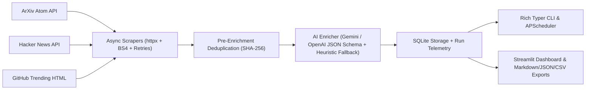

# ⚡ AI Pulse

[](https://francisconguis-ai-pulse-dashboardapp-vwtjtz.streamlit.app/)
[](https://www.python.org/downloads/)
[](https://docs.pydantic.dev/)
[](https://docs.pytest.org/)
[](LICENSE)

**AI Pulse** is an automated Python web scraping and AI intelligence pipeline that monitors **ArXiv** (`cs.AI`, `cs.LG`, `cs.CL`), **Hacker News**, and **GitHub Trending**, enriches new items into structured Pydantic schemas via LLM APIs (with a zero-key heuristic fallback), deduplicates records in **SQLite**, and surfaces insights through a **Rich CLI**, **APScheduler automation**, and an interactive **Streamlit dashboard**.

> **🚀 Live Dashboard:** [Try AI Pulse on Streamlit Cloud](https://francisconguis-ai-pulse-dashboardapp-vwtjtz.streamlit.app/) *(Click **Run Scrape Now** in the sidebar to pull live AI papers, HN stories, and trending GitHub repos!)*

---

## Architecture



---

## Key Engineering Features

- **Concurrent Async Scraping:** Uses `httpx.AsyncClient` and `asyncio.gather` with bounded concurrency (`asyncio.Semaphore`), custom `User-Agent`, and exponential backoff retries on `429`/`5xx` responses.
- **Cost-Aware Pre-Enrichment Deduplication:** Hashes items with SHA-256 and checks SQLite *before* calling the LLM, eliminating duplicate rows and unnecessary token spend.
- **Structured AI Outputs with Graceful Fallback:** Validates Gemini or OpenAI JSON responses against **Pydantic v2** schemas (`summary`, `category`, `tags`, `relevance_score`, `key_takeaway`), and automatically falls back to a deterministic offline heuristic enricher when no API key is configured.
- **Automated Scheduling & Run Telemetry:** Runs recurring interval jobs via `APScheduler` and records per-run metrics (`total_fetched`, `new_items_saved`, `duplicates_skipped`, `errors`) in SQLite.
- **Interactive Dashboard & Exports:** Streamlit UI with one-click live scraping, filtering, category/source/tag analytics charts, and Markdown/JSON/CSV exports.
- **Offline Unit Test Suite:** `pytest` tests covering XML/HTML/JSON scraper parsing, SQLite deduplication/exports, and structured output validation with zero live network calls.

---

## Tech Stack

| Layer | Technologies |
| :--- | :--- |
| **Scraping & Async I/O** | `httpx`, `asyncio`, `BeautifulSoup4`, `xml.etree.ElementTree` |
| **AI & Validation** | Gemini API / OpenAI API (JSON Schema), `Pydantic v2`, Heuristic Fallback |
| **Storage & Exports** | `SQLite3`, JSON, CSV, Markdown Digests |
| **Automation & CLI** | `APScheduler`, `Typer`, `Rich` |
| **Dashboard & Testing** | `Streamlit`, `pandas`, `pytest`, `pytest-asyncio` |

---

## Quickstart & Installation

### Option A: One-Click Launch (Windows)
1. Clone or download this repository.
2. Double-click **`launch_dashboard.bat`** in File Explorer.
3. On the first run, it automatically installs dependencies and opens the **AI Pulse Dashboard** in your browser (`http://localhost:8501`).

### Option B: Manual Setup (Windows / macOS / Linux)

```bash
git clone https://github.com/francisconguis/ai-pulse.git
cd ai-pulse
python -m venv .venv
```

Activate the virtual environment:

```powershell
# Windows (PowerShell / CMD)
.\.venv\Scripts\activate
```

```bash
# macOS / Linux
source .venv/bin/activate
```

Install the package and dev dependencies:

```bash
pip install -e ".[dev]"
```

---

## User Guide: How to Use AI Pulse

### 1. Using the Interactive Web Dashboard (Recommended)

Launch the dashboard by double-clicking **`launch_dashboard.bat`** (Windows) or running:

```bash
ai-pulse dashboard
# or: python -m streamlit run dashboard/app.py
```

Once `http://localhost:8501` opens in your browser:
1. **Scrape Live Data:** In the left sidebar under **🔄 Live Scraper**, pick your sources (`arxiv`, `hackernews`, `github_trending`), set **Max items per source**, and click **🚀 Run Scrape Now**.
2. **Browse & Filter:** Open the **📰 Intelligence Feed** tab to read summaries, key takeaways, relevance scores, and tags. Use the sidebar to filter by **Source**, **Category**, **Min relevance score**, or **Search keywords** (e.g., `agents`, `rag`, `pytorch`).
3. **Explore Trends:** Open the **📊 Analytics** tab to view item counts by category, source breakdown, and top extracted tags.
4. **Download Reports:** Open the **📝 Daily Digest & Export** tab to preview the formatted Markdown intelligence digest and download `.md` or `.json` files with one click.

---

### 2. Using the Command-Line Interface (CLI)

You can also run everything directly from your terminal:

```bash
# Scrape up to 10 items from each source, enrich them, and save to SQLite
ai-pulse scrape --limit 10

# Scrape only specific sources
ai-pulse scrape --source arxiv --source github_trending --limit 10

# View collected items in a formatted terminal table
ai-pulse list --limit 10

# Filter or search stored items
ai-pulse list --source arxiv --search "agent"

# View database statistics
ai-pulse stats

# Generate a Markdown digest (saved to exports/latest_digest.md)
ai-pulse digest

# Export stored items to JSON or CSV (saved in exports/)
ai-pulse export --format json
ai-pulse export --format csv
```

---

### 3. Running in Automated Scheduled Mode

To automatically scrape, deduplicate, enrich, and regenerate `exports/latest_digest.md` on a recurring schedule:

```bash
# Runs immediately, then repeats every 180 minutes (press Ctrl+C to stop)
ai-pulse schedule --interval 180
```

---

### 4. Optional: Enabling LLM Enrichment (Gemini or OpenAI)

By default, AI Pulse runs with **zero API keys required** using its built-in `heuristic` enricher. To enable LLM-powered structured summaries and categorization:

1. Copy `.env.example` to `.env`:
   ```bash
   cp .env.example .env
   ```
2. Add either `GEMINI_API_KEY` or `OPENAI_API_KEY` inside `.env`.
3. Run a scrape from the dashboard or CLI — AI Pulse will automatically switch from `heuristic` to `gemini` or `openai` (and gracefully fall back to `heuristic` if an API request ever fails).

---

## Running Tests

Run the offline unit test suite (no internet connection or API keys required):

```bash
pytest -v
```

---

## Project Structure

```text
ai-pulse/
├── dashboard/
│   └── app.py                    # Interactive Streamlit dashboard
├── src/ai_pulse/
│   ├── ai/enricher.py            # Gemini/OpenAI structured output + heuristic fallback
│   ├── scrapers/
│   │   ├── base.py               # Async httpx client, retries, backoff, rate limiting
│   │   ├── arxiv.py              # ArXiv Atom XML scraper (cs.AI, cs.LG, cs.CL)
│   │   ├── hackernews.py         # Concurrent Hacker News API scraper + AI filter
│   │   └── github_trending.py    # GitHub Trending BeautifulSoup4 HTML scraper
│   ├── cli.py                    # Rich Typer CLI
│   ├── config.py                 # Environment configuration
│   ├── models.py                 # Pydantic v2 schemas
│   ├── pipeline.py               # Async orchestrator & pre-enrichment deduplication
│   ├── scheduler.py              # APScheduler recurring automation
│   └── storage.py                # SQLite repository & JSON/CSV/Markdown exports
├── tests/                        # Offline pytest unit tests
├── launch_dashboard.bat          # One-click Windows launcher for the dashboard
├── LICENSE                       # MIT License
├── pyproject.toml
├── requirements.txt
└── .env.example
```

---

## License

This project is licensed under the [MIT License](LICENSE).
