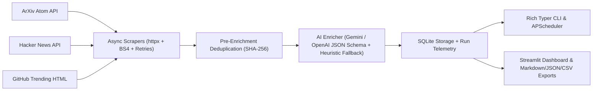

# ⚡ AI Pulse

[](https://www.python.org/downloads/)
[](https://docs.pydantic.dev/)
[](https://streamlit.io/)
[](https://docs.pytest.org/)

**AI Pulse** is an automated Python web scraping and AI intelligence pipeline that monitors **ArXiv** (`cs.AI`, `cs.LG`, `cs.CL`), **Hacker News**, and **GitHub Trending**, enriches new items into structured Pydantic schemas via LLM APIs (with a zero-key heuristic fallback), deduplicates records in **SQLite**, and surfaces insights through a **Rich CLI**, **APScheduler automation**, and an interactive **Streamlit dashboard**.

---

## Architecture



---

## Key Engineering Features

- **Concurrent Async Scraping:** Uses `httpx.AsyncClient` and `asyncio.gather` with bounded concurrency (`asyncio.Semaphore`), custom `User-Agent`, and exponential backoff retries on `429`/`5xx` responses.
- **Cost-Aware Pre-Enrichment Deduplication:** Hashes items with SHA-256 and checks SQLite *before* calling the LLM, eliminating duplicate rows and unnecessary token spend.
- **Structured AI Outputs with Graceful Fallback:** Validates Gemini or OpenAI JSON responses against **Pydantic v2** schemas (`summary`, `category`, `tags`, `relevance_score`, `key_takeaway`), and automatically falls back to a deterministic offline heuristic enricher when no API key is configured.
- **Automated Scheduling & Run Telemetry:** Runs recurring interval jobs via `APScheduler` and records per-run metrics (`total_fetched`, `new_items_saved`, `duplicates_skipped`, `errors`) in SQLite.
- **Interactive Dashboard & Exports:** Streamlit UI with one-click live scraping, filtering, category/source/tag analytics charts, and Markdown/JSON/CSV exports.
- **Offline Unit Test Suite:** `pytest` tests covering XML/HTML/JSON scraper parsing, SQLite deduplication/exports, and structured output validation with zero live network calls.

---

## Tech Stack

| Layer | Technologies |
| :--- | :--- |
| **Scraping & Async I/O** | `httpx`, `asyncio`, `BeautifulSoup4`, `xml.etree.ElementTree` |
| **AI & Validation** | Gemini API / OpenAI API (JSON Schema), `Pydantic v2`, Heuristic Fallback |
| **Storage & Exports** | `SQLite3`, JSON, CSV, Markdown Digests |
| **Automation & CLI** | `APScheduler`, `Typer`, `Rich` |
| **Dashboard & Testing** | `Streamlit`, `pandas`, `pytest`, `pytest-asyncio` |

---

## Quickstart

### 1. Clone & Install

```bash
git clone https://github.com/<your-username>/ai-pulse.git
cd ai-pulse
python -m venv .venv
```

Activate the virtual environment:

```powershell
# Windows (PowerShell / CMD)
.\.venv\Scripts\activate
```

```bash
# macOS / Linux
source .venv/bin/activate
```

Install dependencies:

```bash
pip install -e ".[dev]"
```

### 2. Optional: Configure an LLM API Key

Copy `.env.example` to `.env` and add either `GEMINI_API_KEY` or `OPENAI_API_KEY`:

```bash
cp .env.example .env
```

> **Works out of the box:** If no API key is set, AI Pulse automatically runs in `heuristic` enrichment mode so anyone can test and demo it immediately.

### 3. Run the Pipeline or Dashboard

```bash
# Launch the interactive Streamlit dashboard
ai-pulse dashboard

# Or run from the CLI
ai-pulse scrape --limit 10
ai-pulse list --limit 10
ai-pulse stats
ai-pulse digest
ai-pulse export --format csv

# Run continuously on a schedule (every 180 minutes)
ai-pulse schedule --interval 180
```

### 4. Run Tests

```bash
pytest -v
```

---

## Project Structure

```text
ai-pulse/
├── dashboard/
│   └── app.py                    # Interactive Streamlit dashboard
├── src/ai_pulse/
│   ├── ai/enricher.py            # Gemini/OpenAI structured output + heuristic fallback
│   ├── scrapers/
│   │   ├── base.py               # Async httpx client, retries, backoff, rate limiting
│   │   ├── arxiv.py              # ArXiv Atom XML scraper (cs.AI, cs.LG, cs.CL)
│   │   ├── hackernews.py         # Concurrent Hacker News API scraper + AI filter
│   │   └── github_trending.py    # GitHub Trending BeautifulSoup4 HTML scraper
│   ├── cli.py                    # Rich Typer CLI
│   ├── config.py                 # Environment configuration
│   ├── models.py                 # Pydantic v2 schemas
│   ├── pipeline.py               # Async orchestrator & pre-enrichment deduplication
│   ├── scheduler.py              # APScheduler recurring automation
│   └── storage.py                # SQLite repository & JSON/CSV/Markdown exports
├── tests/                        # Offline pytest unit tests
├── pyproject.toml
├── requirements.txt
└── .env.example
```

---

## License

MIT
